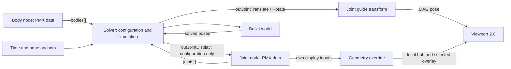

# Joint visualization

How PMX rigid-body **joints** (constraints) are drawn in the viewport and how to
read them. Each joint is a `pmxRigidBodyJoint` node, drawn by
`RigidBodyJointGeometryOverride`.

A joint connects two rigid bodies, **A** and **B**. The display answers two
questions:

- **Unselected:** what kind of motion does each joint allow? This lets you
  compare a joint with its neighbours at a glance.
- **Selected:** which bodies does this joint connect, and what exactly are its
  limits?

## Supported joints

Only **PMX 2.0 joints (Spring6Dof)** are supported. They are simulated with
Bullet's `btGeneric6DofSpringConstraint`, the constraint MMD's Bullet 2.75
creates, with linear limits in body A's frame. PMX 2.1
joint types (6Dof, P2P, ConeTwist, Slider, Hinge) reuse the limit and stiffness
fields with different meanings, so the importer skips them with a warning.
`pmxRigidBodyConstraint` has no joint-type flag at all — it always builds the
one type PMX 2.0 defines.

## How freedom is decided

Every part of the display uses one model (`mmd/core/joint_display.hpp`).
It follows Bullet exactly, with no display thresholds:

| Limits on an axis         | Meaning                                               |
| ------------------------- | ----------------------------------------------------- |
| `min == max`              | **Locked** (at that value, which may be non-zero)     |
| `min < max`               | **Limited**, even if the range is tiny                |
| `min > max`               | **Free** (no limit)                                   |

- Limits are compared at Bullet's float precision, and angles are normalized
  to ±180° first, as Bullet does. A range written as `[-200°, 200°]`
  therefore wraps and becomes free.
- Rotation is measured as XYZ Euler angles, so the **measured Y angle cannot
  pass ±90°**. Turning further reads as Y coming back while X and Z jump by
  180°. With X and Z free, that jump is allowed, so a free Y turns all the way
  round. With X or Z limited, the jump breaks their limit, so the body is held
  near ±90°.
- A **spring** only counts on an axis that can move. Stiffness on a locked axis
  has no effect in Bullet, so it is ignored. This is common in MMD models, which
  often set position spring constants while the position limits are zero.

Unit tests in `tests/unit_tests/core/test_rigid_body_simulation.cpp` confirm
these rules against the simulation itself.

## Unselected joints: the hub

Each joint draws a small solid **hub** at its live attachment on body A. The
hub is the joint's pick target; in wireframe mode it is a wire sphere, so it
stays visible and pickable. Its colour shows what kind of motion the joint
allows:

| Hub                           | The joint…                                 |
| ----------------------------- | ------------------------------------------ |
| Grey                          | is **welded**: nothing can move            |
| Cyan                          | **rotates** only                           |
| Rose                          | **translates** only                        |
| Cyan and rose wedges          | **rotates and translates**                 |
| Hollow, dashed, dark grey     | is **inactive**: it constrains nothing     |

The two-colour hub alternates its wedges all the way round, like a beach
ball, so both colours show from every direction: no part of the display
changes meaning with the viewing angle.

A joint is drawn **inactive** when a body is missing (unconnected or deleted),
both ends are the same body, a body is disabled, or both bodies follow their
bones. That is every answer of `RigidBodySimulation::jointStatus` except
`eActive`, so the display and the solver agree on *why* a joint does nothing —
but they do not draw the same line: the solver still **creates** the constraint
for two bone-driven bodies (it exists in the world and moves nothing, so it can
never be satisfied), while the display shows it hollow. The hub's form (hollow
and dashed, in every display mode) tells it apart from a welded hub, not its
colour.

### A hub that floats away from the model

The hub sits at the joint's position, carried along by body A. A joint is
normally placed where its two bodies meet, so the hub stays on the model even
while it moves. A hub floating far from **both** bodies means the joint itself
is placed out there: the model was authored that way (a joint left at the world
origin is a common physics-converter leftover) and the display is faithful. The
importer's validator reports such joints (`mmd/core/pmx_validate.py`, category
*Physics*) and names them, so they can be fixed in PMX Editor. When their
limits are also free or wider than the model, with no stiffness set, they
cannot affect the simulation at all. That is also why *moving* such a joint
just moves its hub: with the limits never reached, the simulation is unchanged.

Springs are not shown on the hub: a single marker could not say which axis is
sprung. Select a joint to see its springs per axis (see below).

The hub colours (cyan, rose) and the body colours (violet, gold, below) sit
about 90° apart on the colour wheel, away from the axis colours and Maya's
selection green, and stay distinct with the common colour-vision
deficiencies. All joint colours are defined in the palette at the top of
`mmd/maya/nodes/rigid_body_joint_geometry_override.cpp`.

## Selected joints

Selecting a joint (its hub, or its transform) adds overlays:

- **Selection outline**: a wire around the hub in Maya's selection colour
  (green for the lead, white for other selected objects). This is the only
  overlay a joint draws when it is selected through a parent group: selecting
  `{model}_Joints` would otherwise draw hundreds of overlays at once.
- **Bodies**: lines from each body's centre to its own live attachment point.
  Body A is drawn in **violet** and body B in **gold**, and the FORM tells the
  two kinds of marker apart: every **body centre is a small diamond** (an
  octahedron from any view) and every **attachment is a larger round ring**.
  When the two attachments coincide, which is normal for a satisfied joint,
  they share one ring with a gold centre. The connected colliders are outlined
  in the same colours, and a body that is A for one selected joint and B for
  another is **striped violet and gold**. An inactive joint draws only
  **dashed** links from its hub to the bodies it names, and no motion ranges.
- **Motion ranges** (Ranges draw mode), drawn at attachment A: translation in
  its frame, rotation on nested dials (below). Red, green and blue mean local
  **X, Y, Z**:
  - *Translation*: the allowed region at its real size. One movable axis gives
    an offset ruler with witness lines, two give a rectangle, three a box.
    Free axes are open arrows. An axis locked at a non-zero offset shows a
    target cube, with a dashed line from B's current attachment to it.
  - *Rotation*: one arc per axis with end stops and a white zero notch, plus
    a bold **needle** at the joint's current angle, so you can watch a body
    press against its stop during playback. A free axis is a full ring. An
    axis locked at a non-zero angle shows a dashed sweep from zero and a
    target spoke; the sweep is a reference, not an allowed range. The Y arc
    is cut at ±90°: the configured part beyond that is dashed, because the
    joint cannot reach it, and there is no end stop at the cut, because no
    limit stops the body there. A free Y is a full ring when X and Z are free
    too. The arcs are separate per-axis limits, not one combined rotation
    envelope.
  - The dials **nest like a gimbal**. Bullet composes the joint rotation as
    Z (about A's Z axis), then Y, then X (about B's own X axis), so each dial
    lies in the frame its angle is measured in: the outer Z dial stays in A's
    frame, the Y dial turns with the current Z, and the inner X dial turns
    with Z and Y. During playback the Y and X dials follow the body.
  - Arcs, stops and needles are drawn where body B **really turns**. Bullet
    measures joint angles with the opposite sign of a right-handed rotation,
    so a limit `[lo, hi]` is drawn at `[-hi, -lo]`; the needle uses Bullet's
    own measurement, so it always reads against the limits correctly.
  - *Limit hits*: when B presses on a limit, that limit is drawn **bold**.
    On a dial the needle and the stop it touches thicken. On a translation
    ruler the end turns bold in its axis colour; on a rectangle or box, so do
    the edges of each face B touches. "Pressing" means within 2% of the range
    of the limit (at least 0.5° for rotation), or past it. The cut of a Y
    range at ±90° is not a limit, so it never lights up.
  - *Springs*: on a rotation axis with a spring, the arc itself is drawn as a
    zigzag across its whole allowed span, so one element shows both the
    limits and the spring. On a translation axis, a straight zigzag sits along
    the axis. The size does not show stiffness. The white cross or zero notch
    marks the spring's rest point, which this solver always places at zero.

Dashed always means "not reachable": a reference, never an allowed range.

Angular guides, spring badges and markers are sized from the hub, not from
the camera, so every viewport shows the same overlay and it always clears the
hub. Translation regions always keep their physical size.

Joints usually sit inside cloth and hair. The overlay is therefore drawn twice:
a faint **X-ray ghost** that shows through the mesh, and a full-strength pass
that is depth-tested. Parts in front of the mesh look solid; parts behind it
look faint.

If a connected body is hidden, or isolated out of the current view, the
selected joint still draws that body's outline. Isolation, visibility and the
selection are never modified. Isolate-select can only be queried on Maya
2026 and later; on older versions only hidden bodies get this outline.
Turning isolate select on or off (any model-editor change) redraws every
rigid body and joint: Viewport 2.0 could otherwise leave bodies that had been
isolated out undrawn until something else refreshed them.

## Updates during playback

The joint node stores authored PMX data and exposes solver-driven display
inputs. It has no private runtime state: no solver pointer, generation counter,
selection cache or bounds cache. Its Maya callbacks forward input changes to
the geometry override; its bounding-box callback reads its own bounds inputs.



The hub is **local geometry at the node's origin**. The solver drives the guide
to attachment A, so ordinary animation moves its existing geometry through the
DAG. The hidden `solverStep` input carries `outStep` for a directly selected
joint's live overlay. Unselected joints do not request live attachment frames.

`outJointDisplay[i]` connects to the joint's hidden `jointDisplay` compound:
hub radius, active status and local bounds. Only body/joint configuration and
`jointDisplayScale` affect this output; time and animated anchors do not.
Computing it does not build or advance Bullet. Configuration changes reach
the override through ordinary input dirt in DG and Evaluation Manager modes.

At a paused frame the solver also re-runs at once when you drag a bone, edit
a joint or body attribute: each body's and joint's values reach the solver
through a real data connection (`bodies[]` / `joints[]`, compound-to-compound),
so an edit is ordinary DG dirt and the node re-evaluates immediately. The joint
guide transform above the node is a **readout**, driven by the solver
(`outJointTranslate[]` / `outJointRotate[]`), so its channels are locked; edit
`jointRestTranslate` / `jointRestRotate` to move the constraint.

### What is read per frame (and what is rebuilt)

| Data | Refreshed |
| ---- | --------- |
| The hub's pose | never by the display — the solver-driven DAG transform carries it |
| The picked joint's live attachment / body frames | every frame, picked joints only |
| Hub radius, activity and local bounds | solver configuration output, on edits |
| Limits, stiffness, draw mode, freedom and guide sizes | override preparation after edits or a selected-overlay refresh |
| The hub vertices (unit mesh × radius) | first preparation, radius changes or new VP2 stream requirements |
| Item colour / draw mode / enable | override preparation; does not require rebuilding the hub mesh |

The override owns geometry reuse. `isStreamDirty()` reports radius changes;
`isIndexingDirty()` stays false because hub topology is fixed. The solver
computes the model's hub radius from its median rest link and display scale,
and expands each joint's linear ranges by the hub and symbolic guide reach
for its local bounds. A bounding-box query sees an edited size without
advancing the simulation.

**Re-import required for older scenes:** joints created before the display
compound was added lack the `outJointDisplay[i]` connection. Re-create those
joints by re-importing the model; simply loading the scene does not add it.

Joint edits reach the solver through the `joint` → `joints[]` compound
connection, so no edit serial is involved anywhere: the solver re-reads a
joint's or body's records only when that data-block input arrives dirty
(`setDependentsDirty` **and** `preEvaluation`, because Parallel evaluation can
skip the former). Adding a new joint field must be added to both compounds —
the joint node's `joint` and the solver's `joints[]` — because a compound
connection pairs its children by name.

## Jumping in time

One solver step can carry the simulation at most
`RigidBodySimulation::maxStepSpan()` = 0.5 s (the `kMaxStepTime` clamp; the
sub-step budget is sized so the whole span is simulated exactly).
Playback frames (24, 30 or 60 fps) and a multi-frame preview skip are well
inside that, so they are genuinely simulated. A **larger jump forward** —
scrubbing the timeline, loading a motion, jumping to a frame — cannot be
simulated in one step, and stepping anyway would leave every chain lagging
behind the skeleton by the remainder: cloth and hair trail visibly, and the
joints show large attachment separations that look like broken constraints.
Instead the solver **rebuilds** for such a jump: every dynamic body is
re-pinned to the current skeleton pose, exactly as at the rest pose, so the
frame you land on is self-consistent and identical to evaluating it twice.
Rewinding always rebuilt for the same reason.

Editing a joint's `jointRestTranslate` / `jointRestRotate` is an ordinary
input edit on the solver's `joints[]`, so a `cmds.dgeval` (or the next
viewport evaluation) sees it immediately and rebuilds the world at that frame.

## Draw modes

`drawMode` on each joint:

| Value | Label  | Draws                                                            |
| ----- | ------ | ---------------------------------------------------------------- |
| 0     | Off    | nothing                                                          |
| 1     | Hub    | the hub; when selected, the body links and outlines              |
| 2     | Ranges | Hub, plus the selected joint's motion ranges (the default)       |

## Size

All hubs of a model share one size, derived by
`mmd::core::joint_display::hubRadiusForLinks` from the median rest-pose
distance between the bodies its joints link: the median link ×
`kHubLinkFraction`, clamped to `kHubMinRadius`…`kHubMaxRadius`, then scaled by
`kHubSizeFactor` (the one taste constant). Being a median, a few unusually long
or short joints cannot resize every hub. It reads well at any model scale, and
it never changes during the simulation. The guides are sized from the hub. `jointDisplayScale` on the model's
`pmxRigidBodyNode` ("Joint Hub Size" in the Attribute Editor) multiplies every
hub in that model.

## Attributes and units

- The joint's **rest frame** is `jointRestTranslate` / `jointRestRotate` on the
  node, in the bodies' rest space (world at import), so moving the model root
  never re-rigs a joint. Edit those to move the constraint. The transform above
  the node is a solver-driven readout of the **live** attachment on body A
  (`outJointTranslate[]` / `outJointRotate[]`), exactly like a body guide; its
  translate/rotate channels are locked, and its pivot sits on the drawn hub.
- A joint is bounded around its live hub, so Frame Selected (F) works on it.
- `jointBodyA` / `jointBodyB` are **message connections** from the bodies'
  `pmxRigidBodyShape.message`, not indices. The Attribute Editor shows each
  as a field naming the body, with a button that jumps to it. Reconnect one
  to re-target the joint. Deleting a body disconnects it, which makes the
  joint inactive, and never shifts other joints onto the wrong bodies. The
  solver turns the connections into its body indices.
- `jointAngularMin` / `jointAngularMax` are angle attributes. The Attribute
  Editor and `cmds.getAttr`/`setAttr` use Maya's UI angle unit (degrees by
  default); internally they are stored in radians. PMX files and the
  `pmxRigidBodyConstraint` flags use radians.
- `jointLinearStiffness` / `jointAngularStiffness` are Bullet axis stiffnesses,
  taken from the PMX spring constants.

## Trying it

`scripts/maya/joint_glyph_demo.py` builds a gallery of 18 joints, each showing
one case (line, plane, box, fixed offsets, free axes, angular limits, springs,
rotated frames, body modes). It never clears, replaces, or saves your scene:

```python
path = r"<repo>/scripts/maya/joint_glyph_demo.py"
exec(compile(open(path, encoding="utf-8").read(), path, "exec"))
```

This adds a `MMD_ConstraintGallery#` group and opens a dedicated isolated
viewport. Choose a case in the list to select its joint and frame its two
bodies; Alt-drag to orbit, and **Show entire gallery** frames the whole layout
and clears selection. Repeated runs create independent galleries — close the
browser and delete the group when finished. Building a gallery is one undo
chunk; selection changes and later stepping are separate actions.

**Step simulation 30 frames** and **Reset simulation** change only the
gallery's solver time, not your scene timeline. Gravity and collisions are
disabled so the examples stay readable. Fixed-offset targets start
unsatisfied and move toward their target when stepped.

The 18 cases are all PMX 2.0 Spring6Dof joints (zero stiffness behaves as a
plain 6DOF joint): line/plane/box translation regions, fixed offsets, free and
mixed axes, angular limits and offsets, linear/angular springs, a rotated
frame, and dynamic/dynamic and hybrid body pairs. Box, sphere and capsule
colliders cycle through the examples — a representative set, not every numeric
configuration.

The explanation panel reads the selected case's current attributes and reports
LOCKED / LIMITED / FREE with angles in degrees, by the same rules as the
viewport: limits compared at Bullet's float precision, a Y range past ±90°
marked as reaching only ±90°, stiffness on a locked axis marked as having no
effect, and a joint that constrains nothing reported as INACTIVE with the
reason. Use **Refresh parameter explanation after editing** to update it
without reframing. Values outside ±180° are reported as wrapped; the script
never clamps or rewrites parameters.

Two cases are worth knowing about: one uses a white cube for the required
position of attachment B (the gold ring is its actual position, and the dashed
line measures the error), and the last is intentionally unsatisfiable
because both bodies are animation-driven, so its joint is inactive (hollow,
dashed hub).

For scripting without the browser:

```python
import runpy
api = runpy.run_path(path, run_name="gallery_library")
gallery = api["build"](show_ui=False)
api["inspect"](gallery, 8)  # zero-based: angular limits
api["step"](gallery, 30)
api["reset"](gallery)
```

`tests/integration/maya/cmds/test_pmx_rigid_body_constraint_cmd_integration.py`
builds and steps the gallery in Maya standalone. The browser's rendered
appearance still needs interactive verification.

## Implementation map

| File | Role |
| ---- | ---- |
| `mmd/core/joint_display.hpp` | the Maya-free display model: the freedom model (per-axis kinds, effective springs, constraint angles, the `Freedom` summary the hub colour encodes), the hub-size policy (`hubRadiusForLinks`, unit-tested), hub-relative sizes, and the motion-range guide geometry as line segments (unit-tested) |
| `mmd/core/rigid_body_simulation.hpp` | `jointStatus`: whether a joint constrains anything (inactive hubs); `applyShapeSize`: PMX shape_size mapped onto a BodyDefinition |
| `mmd/maya/nodes/rigid_body_display.*` | everything both overrides share: the palette (every colour, one channel per hue), collider outlines and the A/B role wire, the lit stock shader (OpenPBR on 2026+, Blinn before), selection and isolate-select events handled once per session (including the per-viewport `ViewFilter`, resolved once and shared by every joint in that view), shared shaders, which selected joint outlines a shared hidden body, the render-item vertex-buffer filling (`fillMeshBuffers`) and the UV-sphere builder (`appendSphereMesh`) |
| `mmd/maya/nodes/rigid_body_joint.hpp` | the joint node: authored PMX data in `joint`, derived inputs in `jointDisplay`, and stateless Maya callback forwarding; no private runtime members |
| `mmd/maya/nodes/rigid_body_node.*` | the solver: simulation, guide poses and configuration-only `outJointDisplay[]`; `jointViewportFrames()` supplies a picked joint's live overlay |
| `mmd/maya/nodes/rigid_body_joint_geometry_override.*` | the VP2 override: the hub mesh (triangles and wire) and the joint-specific drawing on top of the shared display module |

Headless tests cannot show viewport output. After changing the display, check
it interactively: select and deselect joints, select several, play and rewind
(also with Parallel Evaluation), switch to wireframe and pick a hub, use
several viewports, isolate-select and Show All, hide a connected body, and
look at joints inside cloth (the X-ray ghost). Also delete a body (its
joints turn hollow) and play until a body presses on a limit (bold needle or
face). Two checks are specific to the local-geometry design: **play the
timeline and confirm the hubs (and a picked joint's overlay and links) follow
body A frame by frame**, and **drag `jointDisplayScale` on the solver and
confirm every hub and its bounds resize once the viewport re-evaluates**.
Profile 400 visible, unselected hubs separately from selected overlays in DG,
Serial and Parallel modes. Headless tests cover the connections and values,
but cannot verify VP2 callback counts, buffer reuse or playback FPS.
