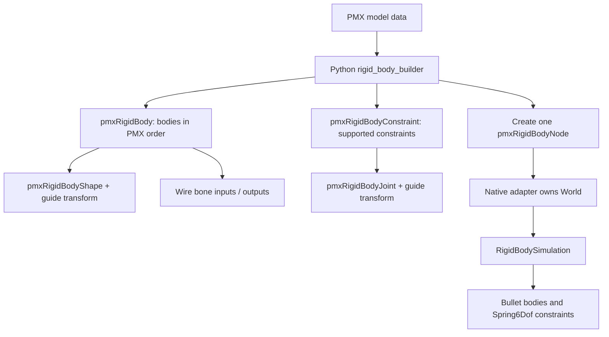
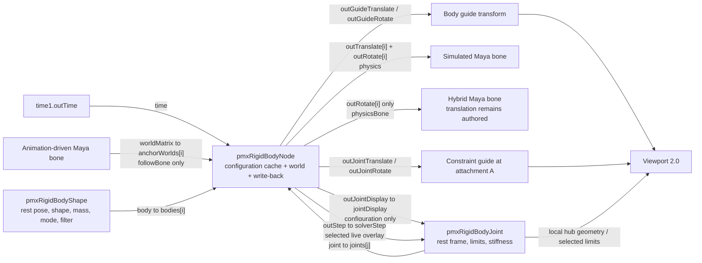
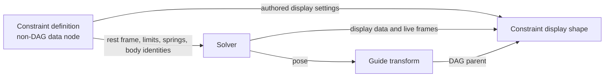
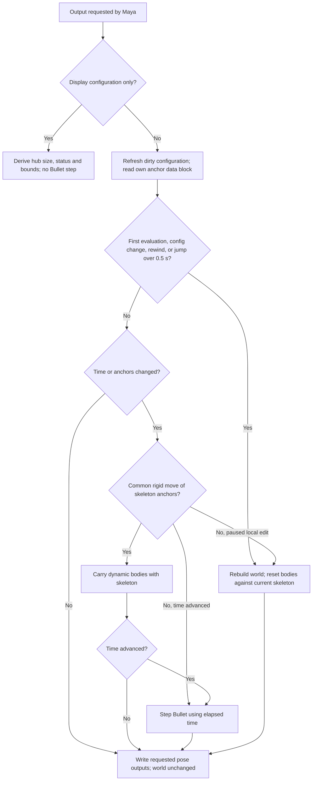

# Rigid bodies — Node and solver flow

## Overview

A Maya skeleton **joint** is a bone transform. A `pmxRigidBodyJoint` is a
**constraint between two colliders**; it is not a skeleton joint and is not a
Maya `parentConstraint`. One `pmxRigidBodyNode` owns the simulation world for
an imported model. Individual body and constraint shapes store authored data
and draw the result; they do not each run a solver.

This overview follows the current native commands, node adapter and core
simulation. The demo below requires no PMX assets.

---

## Architecture

### Creation and ownership



Python creates and edits the graph through commands and attributes. There is
no Python simulation loop, ctypes bridge or separate write-back command.
`RigidBodySimulation` exposes Maya-free data; Bullet details are hidden behind
the simulation implementation and `bullet_bridge`.

### Evaluation connections



These are plug-level dependencies: the same solver can receive a constraint's
configuration and supply its display without a simulation feedback loop.
`bodyShapes[]` and `jointShapes[]` identify nodes and output slots. The body's
`bodyJoint` identifies a bone; `jointBodyA/B` identify body shapes by message
connections. Message links are identity, not per-frame pose transport.

Each body guide contains a `pmxRigidBodyShape`; each constraint guide contains
a `pmxRigidBodyJoint`. The guide transforms are solver readouts. Edit
`bodyRestTranslate/Rotate` or `jointRestTranslate/Rotate` on the shapes to
change the authored setup, rather than moving their driven guides.

### Why the Node Editor shows loops

The current constraint shape has two roles: it **supplies authored data** and
**receives display results**. For case 12 of the flow gallery, the two
constraints use solver slots 0 and 1:

| Connection | Purpose |
| --- | --- |
| `constraint.joint` → `solver.joints[i]` | Authored rest frame, limits and springs |
| `constraint.solver` → `solver.jointShapes[i]` | Identity and body-link changes |
| `solver.outJointDisplay[i]` → `constraint.jointDisplay` | Derived hub radius, activity and bounds |
| `solver.outStep` → `constraint.solverStep` | Evaluation ordering for the selected overlay |
| `solver.outJointTranslate/Rotate[i]` → guide transform | Live attachment pose |

The display inputs do not affect the authored `joint` compound. There is no
`compute()` on `pmxRigidBodyJoint`, and no `attributeAffects` path from
`jointDisplay` or `solverStep` back to the solver inputs. Nevertheless, the
shape lives beneath its driven guide, so the node/DAG topology contains the
path **solver → guide transform → child shape → solver**. Body shapes use
the same authored-data-under-driven-guide pattern.

A Maya 2026 standalone reproduction on 2026-11-23 found:

- `cycleCheck(all=True, list=True, dag=False)` returned no cycles.
- With `dag=True`, it reported paths through driven guides and their child
  body/constraint shapes, including the two constraints in case 12.
- After connecting case 12 to the timeline in the disposable scene and
  animating its anchor, Serial and Parallel evaluation had a non-empty
  evaluation graph but no solver/constraint `cycleCluster` and no reported
  fallback. The same held after keyframing a constraint limit.

These observations distinguish structural loops from demonstrated evaluation
feedback; they are not proof of cycle-free behavior in every scene or in an
interactive viewport. Maya treats attribute-level feedback and node-level
cycle clusters differently; a node-level cluster can be evaluated serially.
See Autodesk's [Parallel Maya guide](https://damassets.autodesk.net/content/dam/autodesk/www/html/using-parallel-maya/2026/UsingParallelMaya.pdf),
[`cycleCheck`](https://help.autodesk.com/cloudhelp/2022/ENU/Maya-Tech-Docs/CommandsPython/cycleCheck.html)
and [`evaluationManager`](https://help.autodesk.com/cloudhelp/2025/ENU/Maya-Tech-Docs/CommandsPython/evaluationManager.html).

To remove these structural loops, a possible refactor is to separate the
authored definition from its display. **The following is a proposal, not the
current implementation:**



The definition must remain outside the driven guide hierarchy. Solver
registration/body identity links would refer to the upstream definition,
and the display would resolve its solver from a downstream input rather
than an outgoing registration link. Selected overlays would keep their
per-frame data in connected inputs; removing connections in favor of hidden
cross-node reads would defeat the evaluation and performance design.

This requires changes to the native nodes/commands, display code, editing UI
and scene compatibility handling. Merely disconnecting `jointDisplay` or
`solverStep` removes display behavior without removing the guide-hierarchy
loop. Splitting body definitions from body display shapes would be the
corresponding change for the body-side loops. No such native refactor is
implemented by this gallery or overview.

---

## Implementation Details

### Body modes and bone direction

| Mode | Collider behavior | Bone connection |
| --- | --- | --- |
| `followBone` (0) | Kinematic, follows bone with a constant rest offset | Bone world matrix → solver anchor; no write-back |
| `physics` (1) | Dynamic | Solver → bone local translation and rotation |
| `physicsBone` (2) | Dynamic | Solver → bone rotation only; translation stays authored |
| Boneless `followBone` | Pinned at its rest pose | Constant anchor, no bone |
| Boneless dynamic body | Simulated collider | Guide output, no bone write-back |

`physicsBone` is not a full bone-world-matrix anchor: a moving collider can
separate from the bone's authored position. In particular, “rotation only”
describes write-back, not a separate constraint type.

For each related bone the adapter derives
`K = jointRestWorld × bodyRestWorld⁻¹`. It reconstructs solved bone worlds from
body poses and the rest offset, then converts them to bone-local outputs
using the parent bone and joint orientation. `pmxBoneIndex` and the
`pmxRestTranslate`, `pmxRestRotate`, `pmxRestJointOrient` attributes let it
resolve hierarchy and rest pose. A body's center need not equal its bone's
origin. The gallery deliberately offsets them by 0.5 cm.

A bone receiving dynamic write-back cannot also supply a live anchor to the
same solver: that would form bone → solver → bone. The body command pins that
mixed bone's follow-body anchor and warns. The demo gives each body its own
bone; it does not intentionally create this cycle.

### Constraints and supported cases

Only PMX 2.0 **Spring6Dof** is implemented (`btGeneric6DofSpringConstraint`).
The importer skips PMX 2.1 joint types with a warning. A hinge-like example is
a Spring6Dof with five locked axes, not a native hinge constraint.

Each axis uses `min == max` for locked, `min < max` for limited, and `min > max`
for free. Springs act on movable axes. Two kinematic bodies cannot be moved
by the solver, so their constraint is drawn inactive. Missing, identical, or
disabled bodies also produce inactive constraints; those invalid pairs are
not instantiated in Bullet. Two kinematic bodies still have a Bullet
constraint, although it cannot correct their poses.

Constraints store one rest frame; Bullet derives an attachment local to each
body. During simulation those two attachment frames can separate because of
allowed movement or constraint error. The visible hub follows attachment A.
See [Joint visualization](./JointVisualization.md) for angular conventions,
spring overlays and the existing 18-case limit gallery.

### One solver evaluation



Configuration arrives through `bodies[]` and `joints[]` and is cached with
dirty callbacks in both DG (`setDependentsDirty`) and Evaluation Manager
(`preEvaluation`). Per-frame anchors arrive through `anchorWorlds[]` and the
node's own `MDataBlock`. Structural bone wiring/rest metadata is resolved
when building the world. Reparenting or rebinding bones is not an ordinary
animated input; recreate the setup when changing that structure.

The world persists between frames. Repeated same-frame output pulls do not
advance physics. Bullet uses 1/60-second substeps; jumps beyond 0.5 seconds
reset instead of attempting to catch up. Cached Playback marks this stateful
node non-cacheable. Timeline evaluation is demand-driven: connecting time
does not itself force an output pull.

The viewport retains local collider/hub geometry and moves it via DAG guide
transforms. Selected constraints request live attachment frames for their
overlay; unselected hubs reuse geometry. This separation is why ordinary
playback does not need to regenerate every hub mesh.

---

## Demo gallery

Run in Maya's **Python** Script Editor with a compatible MayaMMD plugin on
the plugin path:

```python
import runpy
api = runpy.run_path(r"C:/Users/Sebastian/Desktop/MayaMMD/scripts/maya/rigid_body_flow_demo.py",
                     run_name="flow_demo")
gallery = api["build"]()
```

The scene is additive, with a unique `MMD_FlowGallery#` group and one undo
chunk for construction. Repeated runs create separate galleries. There is
no scene clear/save, timeline connection or timeline-range change. Close
the gallery window and delete its root group to remove it.

| Cases | What to compare |
| --- | --- |
| 1–9 | Every ordered A/B pairing of the three body modes, each with visible Maya bones and tip joints |
| 10 | Boneless pinned body constraining a boneless dynamic body |
| 11 | Two boneless dynamic bodies |
| 12 | A parented three-bone chain: follow → physics → hybrid, with two constraints |

Box, sphere and capsule shapes cycle across cases. All constraints allow
limited Z rotation with a spring; translation and X/Y rotation are locked.
Gravity is enabled, collisions are disabled, and there is no floor, so pairs
without a kinematic body fall together. This deliberately isolates constraint
and bone flow from contact response. The runtime mask is zero; it does not
attempt to resolve the PMX importer's documented collision-mask ambiguity.

1. Select the root and Frame Selected to see the layout. The case selector
   selects constraints; their selected overlays expose A/B links and limits.
2. Click **Step 30 ticks** to simulate 0.5 seconds without changing scene time.
   Compare the moving colliders against bone origins and visible bone tips.
3. In the Outliner select a `followBone` bone and move it. Its collider follows.
   Inspect incoming connections on a `physics` bone, then a `physicsBone` bone:
   the latter's translation is still editable. A paused anchor edit can reset
   or carry the simulated bodies as described above.
4. Add a case's solver, bodies, constraints and bones to Maya's Node Editor
   and graph their connections. `api["inspect"](gallery, 0)` prints those node
   names and selects the first constraint (indices are zero-based).
5. **Reset simulation** rewinds solver state at the current anchor pose; it
   does not undo bone edits. Use `api["step"](gallery, 60)` or
   `api["reset"](gallery)` without the UI; `build(show_ui=False)` is batch-safe.

For welded, free, offset, linear/angular spring and rotated-frame variants,
run the companion [constraint gallery](../scripts/maya/joint_glyph_demo.py).
Together these are representative behavior galleries, not an exhaustive
Cartesian product of numeric limits, collision filters, hierarchies and
invalid connections. Viewport appearance needs interactive verification;
standalone checks can verify graph wiring and simulation results only.

---

## Key Source Files

| File | Responsibility |
| --- | --- |
| `mmd/maya/pmx/rigid_body_builder.py` | Import order, native command calls, groups and timeline wiring |
| `mmd/maya/cmds/rigid_body_cmd.cpp` | Body shape creation, anchor input, bone and guide outputs |
| `mmd/maya/cmds/rigid_body_constraint_cmd.cpp` | Constraint creation, body identity links and guide/display wiring |
| `mmd/maya/nodes/rigid_body_node.cpp` | Input caches, world lifecycle, pose conversion, output and display data |
| `mmd/core/rigid_body_simulation.cpp` | Simulation lifecycle and constraint/body behavior |
| `mmd/core/bullet_bridge.hpp` | Bullet integration and conversion helpers |
| `mmd/maya/nodes/rigid_body_shape.*`, `rigid_body_joint.*` | Authored data and display inputs |
| `mmd/maya/nodes/rigid_body_*_geometry_override.*` | Viewport geometry and overlays |
| `scripts/maya/rigid_body_flow_demo.py` | Visible bone/body mode gallery |

---

## References

- [Custom attributes](./CustomAttributes.md)
- [Joint visualization](./JointVisualization.md)
- [C++ development and performance](./CPPDevelopment.md)
- [Naming conventions](./NamingConventions.md)
